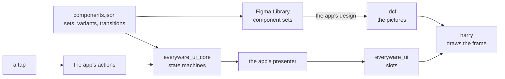

# EveryWare UI

UI components for harry apps on embedded devices: the look is designed in Figma, the behaviour
is written in Rust, and the screen is drawn without the Android framework.


EveryWare UI is the component library of [SDV EveryWare](https://github.com/sdv-everyware/everyware).
It gives an app 22 components, from a button to an on-screen keyboard, named after their
Material 3 roles. The apps run on harry, the Rust UI framework of Android's SDV display stack,
and need no Java, no SurfaceFlinger and no WebView.

**[Components](#components)** · **[Build with a coding agent](#build-your-app-with-a-coding-agent)** · **[Build by hand](#build-your-app-by-hand)** · **[How it works](#how-it-works)** · **[Documentation](#documentation)**

## Components

| Group | Component | What it is |
|---|---|---|
| Actions | [Button](docs/content/button.md) | A text button: filled, tonal or text, in two widths, in a success, warning or error tone. |
| | [Icon button](docs/content/icon_button.md) | A button with one glyph and no label, in two sizes. |
| Selection | [Toggle](docs/content/toggle.md) | An on/off switch. |
| | [Radio](docs/content/radio.md) | A group of options where one is on. |
| | [Segmented button](docs/content/segmented.md) | One choice of two to four. |
| | [Dropdown](docs/content/dropdown.md) | A pill that opens a list of choices below it. |
| | [Slider](docs/content/slider.md) | A value from 0 to 100, dragged with the finger. |
| Navigation | [Tabs](docs/content/tabs.md) | The screen's navigation: a bar of two to four screens. |
| | [Pages](docs/content/pages.md) | Pages that take turns in one place: one page deeper slides in, Back slides it out. |
| Content | [Tile](docs/content/tile.md) | A device's card: symbol, title, value and the device's control. |
| | [List item](docs/content/list_item.md) | One row of a list, with a leading icon or image and a trailing end. |
| | [Bar chart](docs/content/bar_chart.md) | A row of 24 bars. |
| | [Symbol](docs/content/symbol.md) | A glyph on a soft accent background, 48 px. |
| | [Icon](docs/content/icon.md) | A 24 px glyph from Lucide. |
| | [Skeleton](docs/content/skeleton.md) | A placeholder while content loads. |
| | [Scrollbar](docs/content/scrollbar.md) | The thumb of a scrolling list. |
| Over the screen | [Sheet](docs/content/sheet.md) | A dialog or a side sheet with the app's content inside. |
| | [Overlay](docs/content/overlay.md) | The open and close state machine under every sheet. |
| Input | [Input field](docs/content/input_field.md) | A one-line text field. |
| | [Form](docs/content/form.md) | A sheet of input fields that submits on Enter. |
| | [Keyboard](docs/content/keyboard.md) | The on-screen keyboard. |
| | [Keyboard dock](docs/content/keyboard_dock.md) | The screen's one keyboard, open while a field has the focus. |

Each link goes to the component's reference: its Figma set and variants, the parts the code
sets, its transitions, the Rust API and the lines an app writes.

## Get started

**The project is built AI first.** `everyware`, `ui-lib` and every app have an `AGENTS.md`, the
guide a coding agent reads before it touches anything, and the work itself is written down as
**skills**: step by step instructions an agent follows, with the traps. This library's guide is
[AGENTS.md](AGENTS.md).

The library is part of the SDV EveryWare tree. Sync the tree and build the image as described in
[everyware](https://github.com/sdv-everyware/everyware#get-started); the paths below are relative
to the top of that tree.

### Build your app with a coding agent

Open the tree in a coding agent (Claude Code, or any agent that reads `AGENTS.md`) and say what
you want in one sentence. After `repo sync` with the project's manifest the tree's top has
`AGENTS.md` and `CLAUDE.md`, both links to the project's guide, so the agent knows the skills
from the start. It picks the skill and follows it to the board:

| You tell the agent | Skill | What the agent does |
|---|---|---|
| *"Make a kitchen panel: the time and one light, run it on the board."* | [new-app](skills/new-app/SKILL.md) | Shows two or three layouts as sketches and waits for your choice; then the app's own repository, the design on the Library, the build and the run on the board with a screenshot |
| *"Add a switch for the hallway light to the kitchen screen."* | [use-component](skills/use-component/SKILL.md) | The place in the Figma design, the lines in the app, the contract test, the check on the board |
| *"Tapping the Wi-Fi button opens a sheet with the networks."* | [sheet](skills/sheet/SKILL.md) | The sheet's content in Figma, the sheet in the app: the card that slides, the scrim that fades, the keyboard it moves above |
| *"Add a chip component to the library."* | [ui-component](skills/ui-component/SKILL.md) | The spec, the Figma component set, the Rust state machine, the binding to harry, the docs |
| *"The texts on the kitchen screen break into single letters."* | [harry-app](skills/harry-app/SKILL.md) | Finds the cause in the app's traps (here: the fonts the layout helper lacks), fixes it, builds, runs and checks on the board |

Every change ends on a branch of its own. A second agent reviews it with the project's
[review](https://github.com/sdv-everyware/everyware/tree/main/skills/review) skill, and it lands
when you say so.

An agent that wants the library in brief reads [docs/llms.txt](docs/llms.txt): what it is, its
principles and where to read next. People and programs read the same guide per component in
[docs/content](docs/content/) and its code in [docs/examples](docs/examples/).

### Build your app by hand

The skills are also the tutorials: the same steps, for a person. The short version follows.

#### Start a new app

```bash
vendor/sdv-everyware/ui-lib/scripts/new-app.sh kitchen
packages/services/display_safety/utils/kitchen-app/design/build.sh   # the design: data/kitchen.dcf
m kitchen_app
```

`new-app.sh` copies [template-app](https://github.com/sdv-everyware/template-app) into
`packages/services/display_safety/utils/kitchen-app` with its own git repository and every name
changed. It builds as it is; `design/build.sh` makes its design document, and then it runs with
the template's screen: the time, a title, a number and a button that counts up. Then you change its design
and its screen. The full path from an idea to the board is in
[skills/new-app](skills/new-app/SKILL.md).

#### Put a component on a screen

In Figma, the place on the screen is a frame named for the app, with an instance of the
component inside: a frame `#entryway/light` holding a `#toggle`. In the app it takes four places:

```rust
use everyware_ui::toggle::{Toggle, ToggleEvent};

// state.rs: the component owns its state
pub light: Toggle,                       // Toggle::new(false) in State::new

// ui_model.rs: the name is the contract with the design
light: Slot = "#entryway/light" ["SlotCustomizer"];

// presenter.rs: after every action
model.light = slot("#entryway/light", &state.light);

// actions.rs: the gesture goes to the component, which reports what happened
"#entryway/light" => {
    if let Some(ToggleEvent::Toggled(on)) = state.light.on(gesture) {
        // switch the lamp
    }
}
```

The component draws its pressed state, moves its thumb and plays its transition by itself. A
test on the host checks that every name and variant the code uses is in the app's design.

#### Use it in an existing app

Add `"libeveryware_ui"` to the `rustlibs` of the app's `rust_binary` in its `Android.bp`. tv-app's
[Android.bp](https://github.com/sdv-everyware/tv-app/blob/main/Android.bp) is a complete example:
the library and the harry crates an app on it needs.

## How it works

Every frame comes from three sources, and each decides one thing.

| | Decides | Read by |
|---|---|---|
| **Figma** | how it looks: layout, colours, fonts, radii, and every variant of a component as a picture | harry, from the app's `.dcf`, the design document built from the app's design on the Library |
| **The app's Rust code** | what is shown: which variant, which text, which value, and what a tap does | the presenter, after every action |
| **`components.json`** | how a change moves: the duration and the curve of each transition | the Figma generator and the Rust library alike |



On a screen a component sits in a **slot**. harry copies the chosen variant from the Library into
the slot and gives the copy its own texts, opacities and meters, so one component can appear many
times on one screen. A variant carries what rarely changes (kind, disabled, selected); what moves
every frame (pressed, a thumb, a caret) is an opacity or a meter, so it stays smooth.

The library knows nothing about the apps that use it: there is a tile and a list item, never a
weather card or a Wi-Fi row. An app maps its own data to a component's values.

The Library comes in a light theme and a dark theme (`design/dark-theme-patch.js`); tv-app,
hub-app and pairs-app use the dark one.

## Documentation

| | |
|---|---|
| [Overview](docs/content/index.md) | What lives where, the slot, and how a tap travels from the finger to the frame |
| [Rules](docs/content/rules.md) | The twelve rules every app on the library follows |
| [Component guides](docs/content/) | The guide per component: its role, the Figma side, the app side, the traps |
| [Examples](docs/examples/) | The code per component: create it, bind it to its slot, handle its gesture, send the event on; compiled and run by a test |
| [Design workflow](design/WORKFLOW.md) | How the Library is built in Figma and fetched into the `.dcf` |
| [How the docs are built](docs/README.md) | One set of sources for the reference, the guides and the site |

The same content is also an HTML site with a playground per component. It is not in git: run
`node docs/build-docs.js`, then `python3 -m http.server -d docs 8765` and open
`http://localhost:8765/site/`.

## Repository layout

| Path | Contains |
|---|---|
| `components.json` | The spec: component sets, their properties and values, the transitions |
| `core/` | `everyware_ui_core`: state machines, gestures, transitions, the keyboard; no harry, tested on the host |
| `harry/` | `everyware_ui`: the binding to harry (slots, lists, grids, images) |
| `design/` | The Library in Figma: its generator patches, the dark theme, the fetch to the `.dcf` |
| `data/library.dcf` | The Library's own design document, which the contract test reads |
| `docs/` | The reference, the guides, the site and the files for agents |
| `skills/` | The skills for coding agents: `new-app`, `use-component`, `sheet`, `ui-component`, `harry-app` |
| `scripts/` | `new-app.sh`, and `check.sh`, the check run before every commit |

## Build and test

```bash
source device/rb3/sdv_media_db845c/tools/env.sh
m libeveryware_ui everyware_ui_core_test everyware_ui_test everyware_ui_recipes_test
out_rb3/host/linux-x86/nativetest64/everyware_ui_core_test/everyware_ui_core_test
out_rb3/host/linux-x86/nativetest64/everyware_ui_test/everyware_ui_test
out_rb3/host/linux-x86/nativetest64/everyware_ui_recipes_test/everyware_ui_recipes_test
```

`everyware_ui_core_test` covers the state machines. `everyware_ui_test` checks the Figma contract
against `data/library.dcf`. `everyware_ui_recipes_test` compiles the lines each reference page
gives an app.

## Contributing

Every change goes through a branch of its own and a review before it lands; `scripts/check.sh`
runs the tests, the docs and the rules before a commit. The process is in
[AGENTS.md](AGENTS.md) and in the [project's guide](https://github.com/sdv-everyware/everyware/blob/main/AGENTS.md).

## Licence

Apache 2.0, see [LICENSE](LICENSE).
