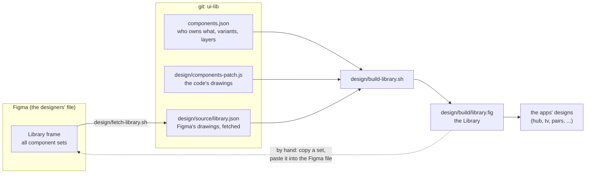
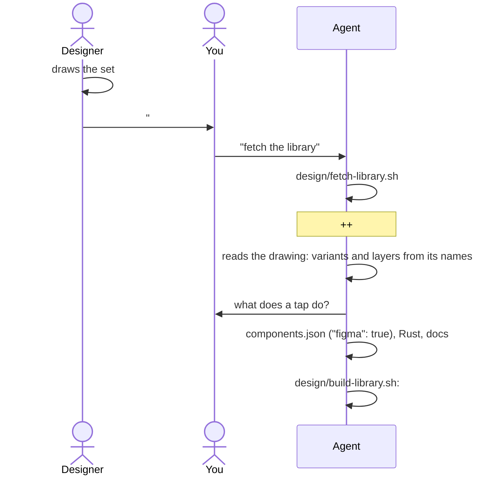
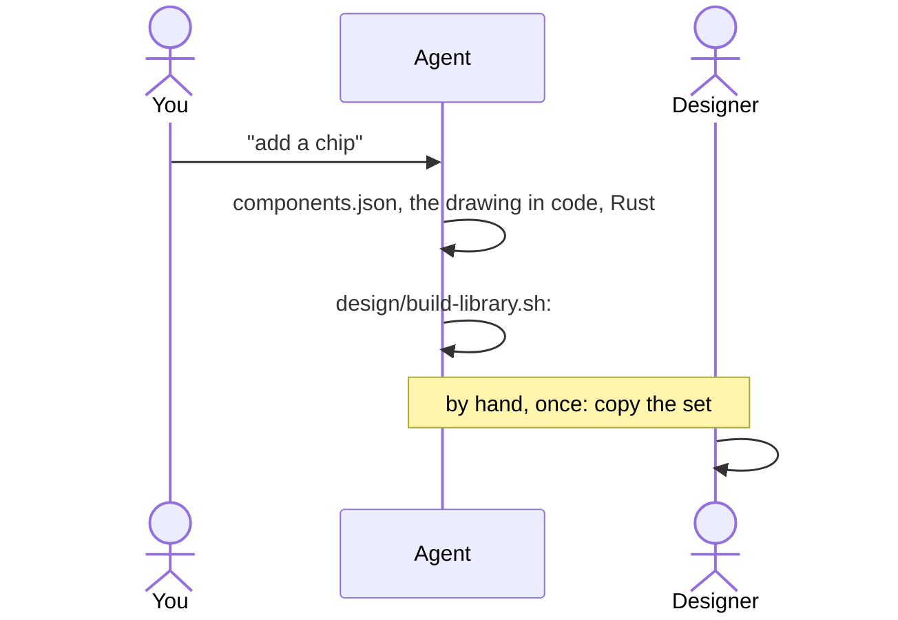
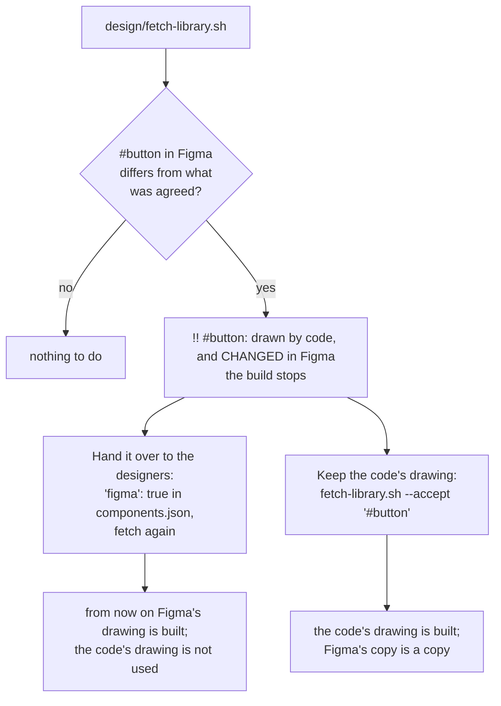
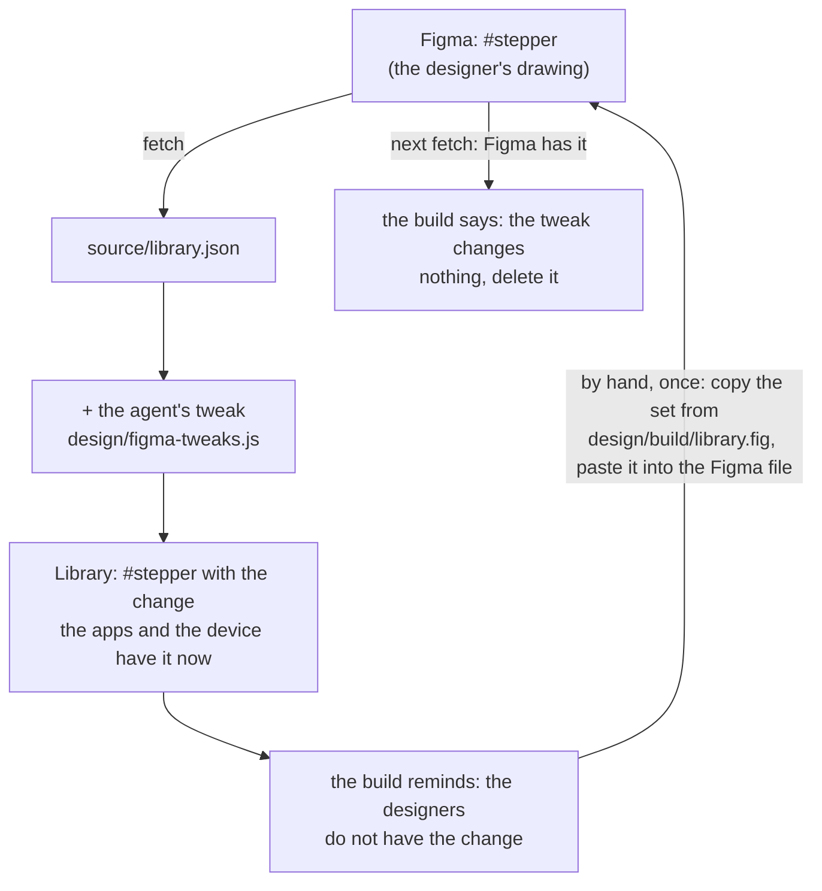

# Who draws the Library: agents and designers

The Library (buttons, toggles, tiles, ...) has two kinds of authors:

- **An AI agent** adds a component when asked ("add a chip"). It draws it with code. Minutes.
- **A designer** draws or changes a component in Figma.

Both end up in the same Library. The rule that keeps them from overwriting each other:

> **Every component has one owner: the code or Figma.** The owner's drawing is the one that is
> built. When the two disagree, the build stops and asks.

The owner is one line in `components.json`: a component with `"figma": true` is drawn in Figma,
every other one by code.

## The picture



Figma can be read from outside (the fetch) and not written: what the code draws reaches the
designers' file by hand, a copy and a paste of the set.

## Case 1: a designer adds a new component



The designer only draws. What the drawing must have, so that the code can drive it:

| In Figma | Example | Why |
|---|---|---|
| A component set named `#<name>` on the page Components, in the frame Library | `#stepper` | the Library is that frame |
| One variant per state, named `property=value, ...` | `state=default`, `state=pressed` | the code picks a variant by this name |
| The layers the code changes, named `#<name>/<part>`, in every variant | `#stepper/value`, `#stepper/pressed` | the code sets a text or an opacity by this name |
| Nothing hidden: opacity 0 instead | | a hidden layer never reaches the device |

The agent writes the contract from those names and the build checks every later fetch against it.

## Case 2: you ask the agent for a component



The component works in the agent's screens at once. The paste into Figma is only needed for the
designers to use it.

## Case 3: a designer changes a component the code owns



Nobody's work is thrown away silently: you decide which drawing counts.

The other way round is noticed too. When the code's drawing of a component changes after the
designers got their copy, the build prints a note: paste the new set into Figma, then
`fetch-library.sh --accept '#<name>'`.

## Case 4: you ask the agent to change a component a designer drew

The drawing stays the designer's. The agent writes a small change on top of it
(`design/figma-tweaks.js`): a colour, a layer the code needs, a variant. The build applies it
every time, so it works at once.



What the designer does: nothing, until someone pastes the changed set into the Figma file. Until
then the device shows the changed component and Figma the old one. A designer who changes the
component in between changes the old look, and the tweak lands on top of the new drawing; when
it no longer fits (a layer it sets is gone), the build names the layer and stops.

## What stays where

| | Owner: code | Owner: Figma (`"figma": true`) |
|---|---|---|
| The look | `design/components-patch.js` | the Figma file, in git as `design/source/library.json` |
| Who changes the look | the agent | a designer, then a fetch; the agent with a tweak on top (`design/figma-tweaks.js`) |
| Variants and layer names | `components.json` | `components.json`, checked against the drawing at every build |
| Behaviour (a tap, a value) | Rust, `core/src/<name>.rs` | the same |
| In Figma | a pasted copy | the original |

## The commands

```bash
# what the designers have, into git (export the token; the file key is local, never committed)
FIGMA_TOKEN=... vendor/sdv-everyware/ui-lib/design/fetch-library.sh [DOC_ID]

# the Library, with Figma's sets in it
vendor/sdv-everyware/ui-lib/design/build-library.sh

# a code-drawn set a designer changed: keep the code
vendor/sdv-everyware/ui-lib/design/fetch-library.sh --accept '#button'

# the same fetch from a .fig, without Figma (a local copy saved from Figma, or a test)
vendor/sdv-everyware/ui-lib/design/fetch-library.sh --local <file.fig>
```

What the fetch prints:

| Line | Meaning | What to do |
|---|---|---|
| `++ #stepper: new in Figma, not in components.json` | a designer added a component | the agent adopts it (ui-component skill, "A component drawn in Figma") |
| `   #stepper: drawn in Figma, changed` | a designer changed their own component | build; the check tells if a variant or a layer is gone |
| `!! #button: drawn by code, and CHANGED in Figma` | two owners | hand it over or `--accept` |
| `!! #stepper: "figma": true ... and not in the Library in Figma` | the designers deleted or renamed it | restore it in Figma, or give it back to the code |

What the build prints about a tweak:

| Line | Meaning | What to do |
|---|---|---|
| `note: #stepper: the code changes Figma's drawing ... the designers do not have the change` | a tweak is at work | paste the set from `design/build/library.fig` into the Figma file |
| `note: #stepper: its tweak changes nothing, Figma has the change` | the paste was done and fetched | delete the tweak from `design/figma-tweaks.js` |

## Limits

- Image fills inside a component are not fetched; the build names the layer and stops.
- A vector drawn in Figma (an icon) is carried as its outline, not as its editable points: the
  device draws the same shape. A file built from the fetch is for the build, not for editing
  that vector again in Figma: the designers edit it in their own file.
- A component of the Library used inside another one (an icon in a button) is carried with the
  changes of its texts, names, opacity, visibility and fills; a swapped component inside is not.
- The designers' file has to be the Library: the frame "Library" on the page "Components". It
  starts as an import of `design/build/library.fig`.
